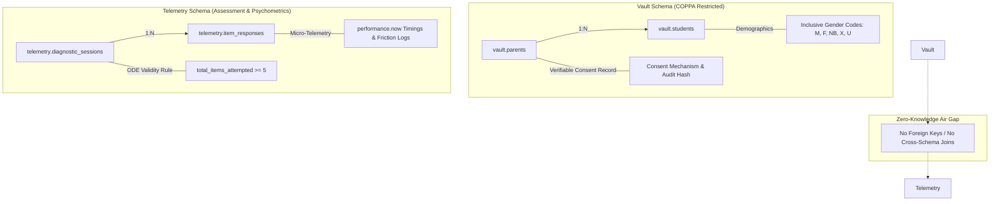

# Sonar Math MVP: Technical Architecture & Compliance Specification

## 1. Executive Summary & System Philosophy
**Sonar Math** is a diagnostic platform designed for K-8 mathematics learning assessments, piloted with a 4th-grade fractions diagnostic. The platform is engineered around two non-negotiable principles:
1. **Strict COPPA / FERPA Zero-Knowledge Isolation:** Child personal identifiable information (PII) is isolated from learning telemetry.
2. **State Accountability & Psychometric Validity:** Strict adherence to Oregon Department of Education (ODE) assessment validity rules (the 5-item attemptedness threshold) and Stanford Education Data Archive (SEDA) demographic covariate alignment.

---

## 2. Dual-Schema Database Architecture

The backend utilizes PostgreSQL (via Supabase) partitioned into two isolated schemas with zero cross-schema relational dependencies:

### 2.1 Schema: `vault` (PII & Consent Records)
* **Objective:** Houses legal guardian consent records under COPPA (16 CFR Part 312) and student profiles. Access is restricted via Row-Level Security (RLS) to verified parents.
* **Tables:**
  - `vault.parents`: Captures guardian email, verified consent timestamp, and authorized COPPA consent mechanisms (`credit_card_verification`, `digital_signature`, `video_conference`, `government_id`, `email_plus_verification`, `school_loco_parentis`). Includes hashed IP address audits.
  - `vault.students`: Stores child name, birth date, grade level, and demographic classifications.
* **Inclusive Gender Coding:** Aligns with modern Oregon Department of Education (ODE) and EDFacts/NCES reporting standards:
  - `M`: Male
  - `F`: Female
  - `NB`: Non-Binary
  - `X`: Another Gender Identity / Non-Binary
  - `U`: Unspecified / Prefer not to state
* **SEDA Alignment:** Retains aggregate-level `state_district_id`, `state_school_id`, and `seda_locale_code` without embedding individual telemetry.

### 2.2 Schema: `telemetry` (Zero-Knowledge Assessment Engine)
* **Objective:** Captures real-time diagnostic performance without PII linkage. Sessions use ephemeral UUIDs generated by client tablets.
* **Tables:**
  - `telemetry.diagnostic_sessions`: Tracks assessment progress, device category (`tablet`, `desktop`), viewport dimensions, sync source (`online_realtime` vs `offline_indexeddb_replay`), and ODE validity.
  - `telemetry.item_responses`: Records granular item responses (1 to 15), target phase (1, 2, or 3), modality (`discrete`, `continuous`, `abstract`), mechanic type (`graduated_cylinder_pour`, `unit_block_grid`, etc.), accuracy, and latency.
* **Micro-Telemetry Timing:**
  - `first_interaction_ms`: High-resolution timestamp (`performance.now()`) from item display to initial user interaction (capturing cognitive processing speed vs freeze).
  - `latency_ms`: Total item response duration.
  - `friction_events_count`: Distinguishes motor-control friction from conceptual mathematical misconception.

---

## 3. Regulatory & State Compliance Rules

### 3.1 Oregon Department of Education (ODE) Attemptedness Rule
* **Rule:** An assessment session is deemed invalid if a student attempts fewer than 5 items.
* **Database Implementation:** Automated PostgreSQL trigger `trg_item_response_after_insert` evaluates item submissions in real-time:
  $$\text{ode\_validity\_cleared} = (\text{total\_items\_attempted} \ge 5)$$
* Sessions with $< 5$ items cannot be marked as validly completed or certified for ODE reporting.

### 3.2 Stanford Education Data Archive (SEDA) Bridge
* SEDA models educational outcomes at district and school levels across socioeconomic and demographic gradients.
* By isolating demographic covariates in `vault` and psychometric performance in `telemetry`, researchers and educators can perform k-anonymized cohort analyses without violating student privacy.

---

## 4. Frontend & Caching State (Ready for Implementation)

| Component | Status | Specifications |
| :--- | :--- | :--- |
| **Database Migrations** | Scaffolded | `supabase/migrations/20261015000001_coppa_vault_and_telemetry.sql` |
| **Typed Models** | Complete | TypeScript interface definitions in `types/database.types.ts` |
| **Questions Engine** | Next (Task 2) | Immutable 15-item schema (`questions.json`) across 3 phases and 3 modalities |
| **Manipulative UI** | Pending (Task 3) | Continuous Fluid Canvas (Graduated cylinder with 2% snap) & Discrete Unit Grid |
| **Offline Cache** | Pending (Task 4) | IndexedDB persistent queue with automatic background replay |

---

## 5. Artifact Directory & File Index
- Migration DDL: [`supabase/migrations/20261015000001_coppa_vault_and_telemetry.sql`](file:///C:/Users/Workstation/.gemini/antigravity-ide/scratch/sonar-math-mvp/supabase/migrations/20261015000001_coppa_vault_and_telemetry.sql)
- Database Typings: [`types/database.types.ts`](file:///C:/Users/Workstation/.gemini/antigravity-ide/scratch/sonar-math-mvp/types/database.types.ts)
- System Architecture: [`architecture.md`](file:///C:/Users/Workstation/.gemini/antigravity-ide/scratch/sonar-math-mvp/architecture.md)
