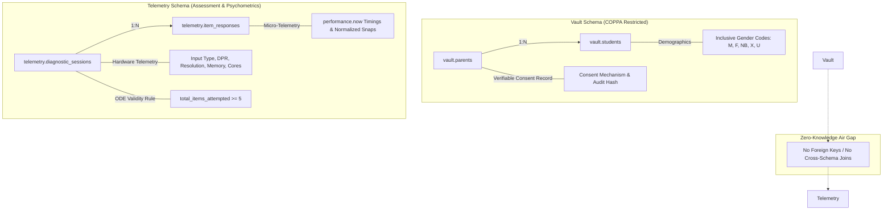

# Sonar Math MVP: Technical Architecture & Compliance Specification

## 1. Executive Summary & Web-First Multi-Device Philosophy
**Sonar Math** is a diagnostic platform designed for K-8 mathematics assessments, piloted with a 4th-grade fractions diagnostic. 
The platform is built **web-first**, architected to run responsively across any modern device—from an 11-inch classroom Chromebook or tablet to a 27-inch teacher workstation monitor.

The system is engineered around three core pillars:
1. **Strict COPPA / FERPA Zero-Knowledge Boundary:** Child personal identifiable information (PII) is structurally isolated in the `vault` schema, while assessment telemetry resides in an unjoined `telemetry` schema.
2. **Multi-Device Unified Input & Responsive Canvas Scaling:** Eliminating motor-skill artifacts through Pointer Events and resolution-invariant normalized coordinate spaces ($\pm 2\%$ snap tolerance).
3. **Hardware-Aware Micro-Telemetry & State Accountability:** Collecting low-level hardware diagnostics to filter device lag from cognitive friction, paired with automated Oregon Department of Education (ODE) 5-item attemptedness rules.

---

## 2. Web-First Multi-Device Frontend Architecture

### 2.1 Unified Pointer Event Handling
Rather than maintaining dual touch/mouse codebases or relying on legacy `onTouchStart` events, all interactive manipulatives use the W3C **Pointer Events API**:
* `onPointerDown`, `onPointerMove`, `onPointerUp`, `onPointerCancel`.
* `element.setPointerCapture(pointerId)`: Prevents lost drag states when a student drags outside the canvas element or over adjacent UI chrome.
* CSS `touch-action: none`: Disables browser default gestures (pinch-to-zoom, pull-to-refresh, page scrolling) during manipulative interaction.
* Identical response mechanics across:
  * Finger touch on capacitive tablets (iPads, Android tablets).
  * Mouse drag on desktop PCs and laptops.
  * Trackpad click-and-drag.
  * Stylus / active pen on touchscreen Chromebooks.

### 2.2 Responsive Canvas Scaling & Invariant $\pm 2\%$ Snap Tolerance
The 2D Continuous Fluid Canvas (graduated cylinder / water jugs) and Discrete Unit Grid do **not** lock to static pixel ratios:
* **Virtual Coordinate Space:** All internal mathematical physics and liquid levels operate within a normalized float space ($[0.0, 1.0]$):
  $$\text{Normalized Fill Ratio } r = \frac{\text{Current Volume}}{\text{Max Capacity}} \in [0.0, 1.0]$$
* **Resolution Independence:** The canvas reads `getBoundingClientRect()` on resize and adjusts `canvas.width = rect.width * window.devicePixelRatio` for razor-sharp rendering on Retina/HiDPI screens.
* **Invariant Tolerance:** The $\pm 2\%$ snap window is calculated strictly in normalized fraction space:
  $$\Delta r = |r_{\text{current}} - r_{\text{target}}| \le 0.02$$
  Whether rendered on a 480px wide mobile viewport or a 2560px 4K monitor, a target of $\frac{3}{4}$ ($0.75$) will always trigger a magnetic snap if the user releases within $[0.73, 0.77]$.

### 2.3 Hardware Telemetry & Friction Disambiguation
In learning analytics, slow response times can stem from two very different phenomena:
1. **Cognitive Hesitation:** The child is thinking, struggling with conceptual fractions, or rereading the prompt.
2. **Device Hardware Lag:** An older budget tablet drops frames during canvas rendering or delays event dispatching.

To prevent false cognitive diagnoses, the platform captures client environment telemetry at session initialization:
* `primary_input_type`: `'touch'`, `'mouse'`, `'stylus'`, or `'trackpad'`.
* `pointer_coarse` & `hover_capable`: Extracted via `window.matchMedia('(pointer: coarse)')` and `matchMedia('(hover: hover)')`.
* `viewport_width`, `viewport_height`, `device_pixel_ratio`.
* `hardware_concurrency` (`navigator.hardwareConcurrency`).
* `device_memory_gb` (`navigator.deviceMemory`).
* `user_agent` (`navigator.userAgent`).

### 2.4 Offline-First Architecture & ODE 5-Item Validity Protection
In home testing environments, Wi-Fi drops, ISP router renewals, and captive portals are common failure modes. If a home router blips during Question 4:
* **Write-Ahead IndexedDB Storage:** The frontend treats the browser's native IndexedDB (`sonar_math_offline_cache`) as the immediate primary source of truth. Every answer, high-resolution timer (`performance.now()`), and interaction trajectory is written and committed to local disk *before* triggering any network dispatch.
* **ODE State Accountability Guarantee:** The Oregon Department of Education invalidates assessments with fewer than 5 attempted items. Under our offline architecture, a student who completes Items 1 through 5 while completely disconnected has their session mathematically protected:
  $$\text{Client State: } \text{total\_items\_attempted} = 5 \implies \text{ode\_validity\_cleared} = \text{true}$$
* **Self-Healing Background Auto-Sync:**
  1. `OfflineSyncManager` listens to `window.online` and performs heartbeat connectivity probes.
  2. Once internet routing is restored, an exponential backoff engine with jitter flushes the queued responses in chronological sequence.
  3. Responses are tagged with `sync_source: 'offline_indexeddb_replay'`, maintaining compliance auditability.
  4. Database idempotent constraints (`uq_session_item`) prevent duplicate insertions on reconnection retries.

## 3. Dual-Schema Database Architecture

The backend utilizes PostgreSQL partitioned into two isolated schemas:

### 3.1 Schema: `vault` (PII & Consent Records)
* `vault.parents`: Verifiable parental consent under COPPA (16 CFR Part 312). Includes consent mechanism, status, timestamps, and hashed IP audits.
* `vault.students`: Child demographic profiles with **inclusive gender codes**:
  * `'M'` = Male, `'F'` = Female, `'NB'` = Non-Binary, `'X'` = Non-Binary / Another Gender Identity, `'U'` = Unspecified / Prefer not to state.
* **SEDA Bridge:** Contains district/school IDs and locale codes for geographic aggregation without individual telemetry linkage.

### 3.2 Schema: `telemetry` (Zero-Knowledge Assessment Engine)
* `telemetry.diagnostic_sessions`: Ephemeral session UUIDs, device category, hardware specifications, and ODE compliance status.
* `telemetry.item_responses`: Granular item responses across 3 phases and 3 modalities (`discrete`, `continuous`, `abstract`), micro-interaction logs, and precision millisecond timings (`first_interaction_ms`, `latency_ms`).

---

## 4. Regulatory & State Compliance Rules

### 4.1 Oregon Department of Education (ODE) Attemptedness Rule
* **Rule:** Assessments where a student attempts fewer than 5 items are invalidated.
* **Database Implementation:** Automated trigger `trg_item_response_after_insert` maintains `total_items_attempted` and updates:
  $$\text{ode\_validity\_cleared} = (\text{total\_items\_attempted} \ge 5)$$
* Ensures unattempted/abandoned sessions are not aggregated into official state reports.

---

## 5. Implementation Roadmap

| Milestone | Deliverable | Status |
| :--- | :--- | :--- |
| **Phase 1 & 2** | Git Safety Net & Local Repo Scaffold | **Complete** (Commit `5230d29`) |
| **Task 1** | COPPA Dual-Schema DDL & Hardware Telemetry Migration | **Complete** (`20261015000001_coppa_vault_and_telemetry.sql`) |
| **Task 1** | TypeScript Data Contracts & Normalized Payload Types | **Complete** (`types/database.types.ts`) |
| **Task 2** | Immutable Question Engine (`questions.json`, 15 items, 3 phases) | **Next** |
| **Task 3** | Responsive Manipulative UI (Pointer Events, Continuous & Discrete) | Pending |
| **Task 4** | Micro-Telemetry Listener & Offline IndexedDB Replay Queue | Pending |

---

## 6. Artifact & File Directory
- Migration DDL: [`supabase/migrations/20261015000001_coppa_vault_and_telemetry.sql`](file:///C:/Users/Workstation/.gemini/antigravity-ide/scratch/sonar-math-mvp/supabase/migrations/20261015000001_coppa_vault_and_telemetry.sql)
- Database Typings: [`types/database.types.ts`](file:///C:/Users/Workstation/.gemini/antigravity-ide/scratch/sonar-math-mvp/types/database.types.ts)
- System Architecture: [`architecture.md`](file:///C:/Users/Workstation/.gemini/antigravity-ide/scratch/sonar-math-mvp/architecture.md)
