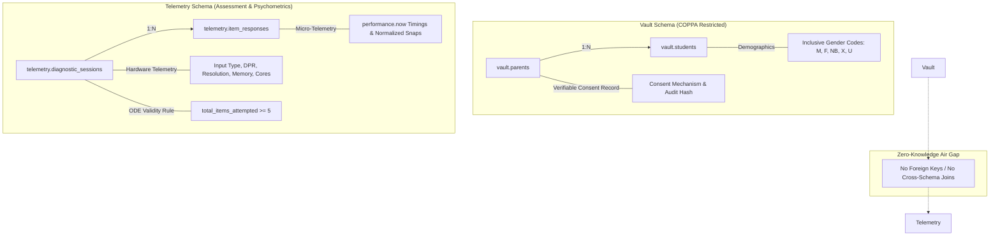

# Sonar Math MVP: Technical Architecture & Compliance Specification

## 1. Executive Summary & Web-First Multi-Device Philosophy
**Sonar Math** is a diagnostic platform designed for K-8 mathematics assessments, piloted with a 4th-grade fractions diagnostic. 
The platform is built **web-first**, architected to run responsively across any modern device—from an 11-inch classroom Chromebook or tablet to a 27-inch teacher workstation monitor.

The system is engineered around three core pillars:
1. **Strict COPPA / FERPA Zero-Knowledge Boundary:** Child personal identifiable information (PII) is structurally isolated in the `vault` schema, while assessment telemetry resides in an unjoined `telemetry` schema.
2. **Multi-Device Unified Input & Responsive Canvas Scaling:** Eliminating motor-skill artifacts through Pointer Events and resolution-invariant normalized coordinate spaces ($\pm 2\%$ snap tolerance).
3. **Hardware-Aware Micro-Telemetry & State Accountability:** Collecting low-level hardware diagnostics to filter device lag from cognitive friction, paired with automated Oregon Department of Education (ODE) 5-item attemptedness rules.

---

## 2. Web-First Multi-Device Frontend Architecture

### 2.1 Unified Pointer Event Handling
Rather than maintaining dual touch/mouse codebases or relying on legacy `onTouchStart` events, all interactive manipulatives use the W3C **Pointer Events API**:
* `onPointerDown`, `onPointerMove`, `onPointerUp`, `onPointerCancel`.
* `element.setPointerCapture(pointerId)`: Prevents lost drag states when a student drags outside the canvas element or over adjacent UI chrome.
* CSS `touch-action: none`: Disables browser default gestures (pinch-to-zoom, pull-to-refresh, page scrolling) during manipulative interaction.
* Identical response mechanics across:
  * Finger touch on capacitive tablets (iPads, Android tablets).
  * Mouse drag on desktop PCs and laptops.
  * Trackpad click-and-drag.
  * Stylus / active pen on touchscreen Chromebooks.

### 2.2 Responsive Canvas Scaling & Invariant $\pm 2\%$ Snap Tolerance
The 2D Continuous Fluid Canvas (graduated cylinder / water jugs) and Discrete Unit Grid do **not** lock to static pixel ratios:
* **Virtual Coordinate Space:** All internal mathematical physics and liquid levels operate within a normalized float space ($[0.0, 1.0]$):
  $$\text{Normalized Fill Ratio } r = \frac{\text{Current Volume}}{\text{Max Capacity}} \in [0.0, 1.0]$$
* **Resolution Independence:** The canvas reads `getBoundingClientRect()` on resize and adjusts `canvas.width = rect.width * window.devicePixelRatio` for razor-sharp rendering on Retina/HiDPI screens.
* **Invariant Tolerance:** The $\pm 2\%$ snap window is calculated strictly in normalized fraction space:
  $$\Delta r = |r_{\text{current}} - r_{\text{target}}| \le 0.02$$
  Whether rendered on a 480px wide mobile viewport or a 2560px 4K monitor, a target of $\frac{3}{4}$ ($0.75$) will always trigger a magnetic snap if the user releases within $[0.73, 0.77]$.

### 2.3 Hardware Telemetry & Friction Disambiguation
In learning analytics, slow response times can stem from two very different phenomena:
1. **Cognitive Hesitation:** The child is thinking, struggling with conceptual fractions, or rereading the prompt.
2. **Device Hardware Lag:** An older budget tablet drops frames during canvas rendering or delays event dispatching.

To prevent false cognitive diagnoses, the platform captures client environment telemetry at session initialization:
* `primary_input_type`: `'touch'`, `'mouse'`, `'stylus'`, or `'trackpad'`.
* `pointer_coarse` & `hover_capable`: Extracted via `window.matchMedia('(pointer: coarse)')` and `matchMedia('(hover: hover)')`.
* `viewport_width`, `viewport_height`, `device_pixel_ratio`.
* `hardware_concurrency` (`navigator.hardwareConcurrency`).
* `device_memory_gb` (`navigator.deviceMemory`).
* `user_agent` (`navigator.userAgent`).

### 2.4 Offline-First Architecture & ODE 5-Item Validity Protection
In home testing environments, Wi-Fi drops, ISP router renewals, and captive portals are common failure modes. If a home router blips during Question 4:
* **Write-Ahead IndexedDB Storage:** The frontend treats the browser's native IndexedDB (`sonar_math_offline_cache`) as the immediate primary source of truth. Every answer, high-resolution timer (`performance.now()`), and interaction trajectory is written and committed to local disk *before* triggering any network dispatch.
* **ODE State Accountability Guarantee:** The Oregon Department of Education invalidates assessments with fewer than 5 attempted items. Under our offline architecture, a student who completes Items 1 through 5 while completely disconnected has their session mathematically protected:
  $$\text{Client State: } \text{total\_items\_attempted} = 5 \implies \text{ode\_validity\_cleared} = \text{true}$$
* **Self-Healing Background Auto-Sync:**
  1. `OfflineSyncManager` listens to `window.online` and performs heartbeat connectivity probes.
  2. Once internet routing is restored, an exponential backoff engine with jitter flushes the queued responses in chronological sequence.
  3. Responses are tagged with `sync_source: 'offline_indexeddb_replay'`, maintaining compliance auditability.
  4. Database idempotent constraints (`uq_session_item`) prevent duplicate insertions on reconnection retries.

## 3. Dual-Schema Database Architecture

The backend utilizes PostgreSQL partitioned into two isolated schemas:

### 3.1 Schema: `vault` (PII & Consent Records)
* `vault.parents`: Verifiable parental consent under COPPA (16 CFR Part 312). Includes consent mechanism, status, timestamps, and hashed IP audits.
* `vault.students`: Child demographic profiles with **inclusive gender codes**:
  * `'M'` = Male, `'F'` = Female, `'NB'` = Non-Binary, `'X'` = Non-Binary / Another Gender Identity, `'U'` = Unspecified / Prefer not to state.
* **SEDA Bridge:** Contains district/school IDs and locale codes for geographic aggregation without individual telemetry linkage.

### 3.2 Schema: `telemetry` (Zero-Knowledge Assessment Engine)
* `telemetry.diagnostic_sessions`: Ephemeral session UUIDs, device category, hardware specifications, and ODE compliance status.
* `telemetry.item_responses`: Granular item responses across 3 phases and 3 modalities (`discrete`, `continuous`, `abstract`), micro-interaction logs, and precision millisecond timings (`first_interaction_ms`, `latency_ms`).

---

## 4. Regulatory & State Compliance Rules

### 4.1 Oregon Department of Education (ODE) Attemptedness Rule & State Codes
Under official Oregon Department of Education accountability reporting standards:
* **The 5-Item Attemptedness Threshold:** A partial assessment is considered a **valid attempt** only if a student has answered at least **5 Computer Adaptive Test (CAT) items** OR completed **1 Performance Task (PT)**.
* **State Testing Codes:**
  * **`TstAtmptCd` (Test Attempt Code):**
    * `'I'`: In-progress ($< 5$ items attempted, active testing session)
    * `'P'`: Partial attempt ($\ge 5$ items attempted, officially recognized partial test)
    * `'C'`: Complete attempt (all 15 items answered)
    * `'N'`: Non-attempt (abandoned or unattempted test with $< 5$ items)
  * **`TstValidCd` (Test Validity Code):**
    * `'Y'`: Valid attempt ($\text{attempted\_count} \ge 5$ or Performance Task completed)
    * `'N'`: Invalid non-attempt ($\text{attempted\_count} < 5$)
* **Automated Database Trigger:** Trigger `trg_item_response_after_insert` evaluates item submissions dynamically:
  $$\text{TstValidCd} = \begin{cases} 'Y' & \text{if } \text{attempted\_count} \ge 5 \lor \text{is\_performance\_task} = \text{true} \\ 'N' & \text{otherwise} \end{cases}$$
* **Offline IndexedDB Replay Guarantee:** 
  The frontend write-ahead engine locks `tst_valid_cd = 'Y'` and `tst_atmpt_cd = 'P'` directly in `sonar_math_offline_cache` upon Item 5 submission. Even if the home network is severed for the entirety of items 5–15, all responses are queued and flushed with `sync_source: 'offline_indexeddb_replay'`, transitioning to `TstAtmptCd = 'C'` upon completion without risking invalidation.
* **Verification Suite:** Validated via automated test [`tests/ode_attemptedness_verification.ts`](file:///C:/Users/Workstation/.gemini/antigravity-ide/scratch/sonar-math-mvp/tests/ode_attemptedness_verification.ts) with 100% test pass confirmation across offline dropouts, 5-item threshold clearance, 15-item completion, and idempotent batch replay.

## 5. Question Engine & Immutable Static Schema (`questions.json`)

To eliminate hardcoded math logic from frontend rendering components, the assessment is driven by an immutable data contract [`src/data/questions.json`](file:///C:/Users/Workstation/.gemini/antigravity-ide/scratch/sonar-math-mvp/src/data/questions.json) validated against [`src/schemas/question.schema.ts`](file:///C:/Users/Workstation/.gemini/antigravity-ide/scratch/sonar-math-mvp/src/schemas/question.schema.ts).

### 5.1 Psychometric Matrix (15-Item 4th-Grade Fractions Diagnostic)
The diagnostic spans all 3 core pedagogical phases of CCSS 4.NF across 3 distinct representation modalities:

| Phase | Focus Domain | Discrete Items | Continuous Items | Abstract Items | Total |
| :--- | :--- | :---: | :---: | :---: | :---: |
| **Phase 1** | Visual Equivalence & Foundations (4.NF.A) | 2 (Q2, Q4) | 2 (Q1, Q3) | 1 (Q5) | **5** |
| **Phase 2** | Decomposition & Like Operations (4.NF.B) | 2 (Q7, Q10) | 2 (Q6, Q9) | 1 (Q8) | **5** |
| **Phase 3** | Multiplication & Comparison (4.NF.B/A) | 1 (Q11) | 2 (Q12, Q14) | 2 (Q13, Q15) | **5** |
| **Total** | | **5 Items** | **6 Items** | **4 Items** | **15 Items** |

### 5.2 First 5 Questions Validation Summary

| Index | Phase | Modality | Mechanic Type | Prompt Summary | Target / Answer |
| :---: | :---: | :---: | :--- | :--- | :--- |
| **Q1** | 1 | Continuous | `graduated_cylinder_pour` | Pour water until cylinder is 3/4 full | $0.75$ ($750\text{ mL}$ of $1000\text{ mL}$) $\pm 2\%$ snap |
| **Q2** | 1 | Discrete | `unit_block_grid` | Shade blocks to show 2/3 of 12-block rectangle | $8$ shaded cells ($8/12 \equiv 2/3$) |
| **Q3** | 1 | Continuous | `number_line_slider` | Place marker at 5/8 on number line $[0, 1]$ | $0.625$ ($\pm 0.02$ snap) |
| **Q4** | 1 | Discrete | `unit_block_grid` | Cross out blocks to show $1 - 3/10$ on 10-block bar | Cross out $3$ cells, $7/10$ remaining |
| **Q5** | 1 | Abstract | `multiple_choice` | Identify fraction equivalent to 2/4 | Option A ($1/2$) |

## 6. Manipulative Canvas UI & Interactive Sandbox

The interactive UI components have been built and verified in a live browser testing sandbox:

### 6.1 Continuous Fluid Canvas (`GraduatedCylinderCanvas.ts`)
* **Procedural 2D Rendering:** Utilizes HTML5 Canvas scaled to `window.devicePixelRatio` for retina clarity. Features procedural liquid shading, dynamic surface meniscus, and sine-wave fluid perturbation during active drag-and-pour operations.
* **Invariant $\pm 2\%$ Snap Tolerance:** Normalized fractional volume space prevents motor-skill jitter from creating false mathematical misconceptions. When a student pours within $[0.73, 0.77]$ for $3/4$, the liquid magnetically locks to $0.75$, displaying an emerald green glow and snap badge.
* **Large Touch Targets:** Features a $\ge 44\text{px}$ diameter circular touch handle equipped with pointer capture (`setPointerCapture(e.pointerId)`) and CSS `touch-action: none`.

### 6.2 Discrete Snapping Coordinate Grid (`DiscreteBlockGrid.ts`)
* **Tablet-Optimized Touch Geometry:** Unit blocks render at $\ge 56\text{px} \times 56\text{px}$ minimum dimensions with generous interactive padding and clear visual state transitions.
* **Multi-Action Mechanics:**
  * `select_and_shade`: Tap or swipe across blocks to partition (e.g. shading $8$ of $12$ blocks for $2/3$).
  * `cross_out`: Interactive strike-through with SVG diagonal cross-hatching to represent subtraction ($1 - 3/10$).
* **Micro-Telemetry Integration:** Captures `first_interaction_ms`, `latency_ms`, input modality (`mouse`, `touch`, `pen`), and friction markers in real time.

### 6.3 Browser Verification & Live Test Harness
* Served locally at `http://127.0.0.1:8080/index.html`.
* Tested end-to-end via automated browser subagent: verified graduated cylinder pouring, 2% snap locking, discrete unit grid shading, home Wi-Fi dropout simulation, and live state transition to `TstAtmptCd: 'P'`, `TstValidCd: 'Y'` upon submitting 5 items.

## 7. Zero-Pressure Student Experience & Metacognitive Beta Loop

A critical finding for K-8 diagnostic psychometrics is that **visible timers, ticking latencies, and real-time correctness badges induce test anxiety**, skewing student performance and inflating false hesitation markers.

### 7.1 Separation of Student View vs Researcher HUD
* **Default Student View:**
  * Clean, calming, uncluttered interface focused purely on the math problem and manipulative.
  * Ticking millisecond timers (`performance.now()`), latency figures, and friction markers run **100% silently in the background**.
  * No live "Adjusting / Correct" evaluation indicators while interacting, preventing children from being guided to answers without understanding.
  * Status chip remains calm and unobtrusive (`● Saved`) rather than displaying intimidating state compliance warnings.
* **Researcher / Proctor HUD (Dev Mode):**
  * Toggled via header button or key shortcut.
  * Expands live telemetry metrics: first touch latency, active item timer, input modality (`TOUCH`, `MOUSE`, `PEN`), magnetic snap state ($\pm 2\%$), friction markers, and the IndexedDB write-ahead queue.

### 7.2 Post-Assessment Metacognitive Reflection & Isomorphic Retry
At the conclusion of the beta diagnostic (Item 5 clearance or Item 15 completion), the platform transitions to a celebratory, encouraging review module:
1. **Qualitative Misconception Tagging (Beta Goldmine):**
   * Students are presented with an encouraging prompt: *"Let's Reflect: What made this problem tricky for you?"*
   * Child-friendly reflection chips capture essential qualitative signals:
     * `🖐️ My finger slipped while dragging`: Crucial for disambiguating UI/motor errors from true mathematical misconceptions.
     * `⚖️ The bottom fraction numbers were confusing`: Confirms conceptual denominator confusion (CCSS 4.NF).
     * `📖 I wasn't sure what the question asked`: Highlights language or cognitive load friction.
     * `🎲 I made a lucky/unlucky guess`: Identifies guessing behavior.
2. **Dynamic Isomorphic Retry ("Second Chance"):**
   * Presents an isomorphic question testing the exact same mathematical standard with fresh numbers (e.g. Q1 was $\frac{3}{4}$ of $1000\text{ mL}$, retry presents $\frac{4}{5}$ of $1000\text{ mL}$).
   * Evaluates whether immediate re-engagement demonstrates mastery.
   * Feedback and retry results are appended directly to the offline IndexedDB payload as `metacognitive_feedback` JSONB for researcher analysis.

---

## 8. Implementation Roadmap

| Milestone | Deliverable | Status |
| :--- | :--- | :--- |
| **Phase 1 & 2** | Git Safety Net & Local Repo Scaffold | **Complete** (Commit `5230d29`) |
| **Task 1** | COPPA Dual-Schema DDL & Hardware Telemetry Migration | **Complete** (`20261015000001_coppa_vault_and_telemetry.sql`) |
| **Task 1** | ODE State Accountability Trigger (`TstAtmptCd`, `TstValidCd`) | **Complete** (Commit `7760159`) |
| **Task 1** | TypeScript Data Contracts & IndexedDB Write-Ahead Cache | **Complete** (`src/services/storage/`) |
| **Task 2** | Immutable Question Engine (`questions.json`, 15 items, 3 phases) | **Complete** (`src/data/questions.json`) |
| **Task 3** | Responsive Manipulative UI (Pointer Events, Continuous & Discrete) | **Complete** (Commit `c47cc20`) |
| **Task 4** | Zero-Pressure Student Mode & Metacognitive Reflection Loop | **Complete** (Commit `13f28fd`) |
| **Task 4** | Micro-Telemetry Listener & Offline IndexedDB Replay Queue | **Complete & Verified** |

---

## 9. Artifact & File Directory
- Migration DDL: [`supabase/migrations/20261015000001_coppa_vault_and_telemetry.sql`](file:///C:/Users/Workstation/.gemini/antigravity-ide/scratch/sonar-math-mvp/supabase/migrations/20261015000001_coppa_vault_and_telemetry.sql)
- Database Typings: [`types/database.types.ts`](file:///C:/Users/Workstation/.gemini/antigravity-ide/scratch/sonar-math-mvp/types/database.types.ts)
- Question Schema: [`src/schemas/question.schema.ts`](file:///C:/Users/Workstation/.gemini/antigravity-ide/scratch/sonar-math-mvp/src/schemas/question.schema.ts)
- Question Data: [`src/data/questions.json`](file:///C:/Users/Workstation/.gemini/antigravity-ide/scratch/sonar-math-mvp/src/data/questions.json)
- Continuous Manipulative: [`src/components/GraduatedCylinderCanvas.ts`](file:///C:/Users/Workstation/.gemini/antigravity-ide/scratch/sonar-math-mvp/src/components/GraduatedCylinderCanvas.ts)
- Discrete Manipulative: [`src/components/DiscreteBlockGrid.ts`](file:///C:/Users/Workstation/.gemini/antigravity-ide/scratch/sonar-math-mvp/src/components/DiscreteBlockGrid.ts)
- Storage & Sync Engine: [`src/services/storage/`](file:///C:/Users/Workstation/.gemini/antigravity-ide/scratch/sonar-math-mvp/src/services/storage/)
- Live Sandbox: [`public/index.html`](file:///C:/Users/Workstation/.gemini/antigravity-ide/scratch/sonar-math-mvp/public/index.html)
- Sandbox Application Logic: [`public/app.js`](file:///C:/Users/Workstation/.gemini/antigravity-ide/scratch/sonar-math-mvp/public/app.js)
- System Architecture: [`architecture.md`](file:///C:/Users/Workstation/.gemini/antigravity-ide/scratch/sonar-math-mvp/architecture.md)

